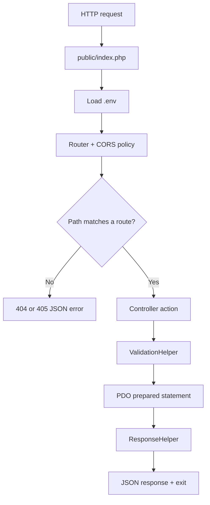

# kutayertug.com — Personal Website & Blog API

A lightweight JSON API that powers a personal website and an engineering blog
focused on **web** and **low-level systems**. Built on **plain PHP 8** with a
small, hand-written MVC layer — no heavy framework, no ORM, no magic.

Every response is JSON, every query is a prepared statement, and only the
`public/` directory is exposed to the web. Everything else (application code,
configuration, SQL dumps) lives outside the document root.

---

## Table of Contents

- [Overview](#overview)
- [Features](#features)
- [Tech Stack](#tech-stack)
- [Architecture](#architecture)
- [Requirements](#requirements)
- [Installation](#installation)
  - [1. Clone the repository](#1-clone-the-repository)
  - [2. Install dependencies](#2-install-dependencies)
  - [3. Configure the environment](#3-configure-the-environment)
  - [4. Set up the database](#4-set-up-the-database)
  - [5. Serve the application](#5-serve-the-application)
  - [6. Verify the installation](#6-verify-the-installation)
- [Configuration](#configuration)
- [Database Schema](#database-schema)
- [Security Notes](#security-notes)
- [License](#license)

---

## Overview

This repository contains the **backend API** for a personal website and blog.
The public frontend (a separate application) consumes these endpoints over
HTTP, which is why CORS is configurable and the response contract is strictly
uniform.

The project intentionally avoids a full framework:

- **Routing** is handled by a custom router with groups, route parameters,
  named routes, and a middleware pipeline.
- **Persistence** uses PDO directly, with prepared statements and an
  associative fetch mode.
- **Responses** always go through a single helper, so the JSON envelope can
  never drift between endpoints.
- **Validation** uses a small fluent helper instead of scattered `if` blocks.

---

## Features

- Hand-written router: route groups, `{param}` and `{param?}` placeholders,
  named routes, per-route and global middleware, automatic `405`/`404` handling
- PSR-4 autoloading via Composer (`App\` → `App/`)
- `.env`-based configuration using `vlucas/phpdotenv`
- PDO/MySQL with prepared statements, exception error mode, and UTC timezone
- Uniform JSON response envelope for success and error cases
- Fluent, chainable request validation with field-level error reporting
- JWT service (HS256) for upcoming authentication
- Configurable CORS whitelist and baseline security headers
- Public-document-root isolation: only `public/` is web-accessible
- Paginated blog listing, slug-based post lookup, and contact submissions

---

## Tech Stack

| Layer | Technology |
| --- | --- |
| Language | PHP ≥ 8.0 (developed against 8.5) |
| Database | MySQL / MariaDB (UTF-8 `utf8mb4`) |
| Web server | Nginx, Apache, or Caddy in front of PHP-FPM |
| Dependency manager | Composer 2 |
| JWT | `firebase/php-jwt` ^7.0 |
| Environment | `vlucas/phpdotenv` ^5.6 |
| Password hashing | Argon2id (see `users.password`) |

---

## Architecture



### Project structure

```text
api/
├── App/
│   ├── Controllers/         # Request handlers (business logic)
│   │   ├── BaseController.php     # Shared PDO connection + JSON body parsing
│   │   ├── BlogController.php     # Blog listing and slug lookup
│   │   ├── ContactController.php  # Contact form submissions
│   │   └── UserController.php     # Public user profiles
│   ├── Core/
│   │   ├── Database.php     # Lazy PDO singleton
│   │   └── Router.php       # Route registry, groups, params, middleware, CORS
│   ├── Helpers/
│   │   ├── HeaderHelper.php       # Cross-SAPI request header access
│   │   ├── ResponseHelper.php     # Uniform JSON response envelope
│   │   └── ValidationHelper.php   # Fluent request validation
│   └── Services/
│       ├── HeaderService.php      # CORS, security and cache headers
│       └── JWTService.php         # HS256 token generation and verification
├── Database/
│   └── database.sql         # Schema + seed data
├── public/                  # ← the only web-exposed directory
│   ├── .htaccess            # Front-controller rewrite
│   └── index.php            # Bootstrap, route definitions, dispatch
├── .env-example             # Environment template
├── composer.json            # Dependencies + PSR-4 autoload
└── README.md
```

`vendor/` and `.env` are ignored by Git.

---

## Requirements

- **PHP 8.0+** with the `pdo_mysql` extension (`mbstring` recommended)
- **Composer 2**
- **MySQL 5.7+** or **MariaDB 10.x**
- **PHP-FPM** in production, or PHP's built-in development server locally
- **Nginx**, **Apache**, or **Caddy** as the reverse proxy in production

---

## Installation

### 1. Clone the repository

```bash
git clone <repository-url> api
cd api
```

### 2. Install dependencies

`vendor/` is not committed, so dependencies must be installed first:

```bash
composer install
```

For a production deployment:

```bash
composer install --no-dev --optimize-autoloader
```

### 3. Configure the environment

Copy the template and fill in your values:

```bash
cp .env-example .env
```

```powershell
# Windows PowerShell
Copy-Item .env-example .env
```

Generate a strong JWT secret:

```bash
php -r "echo bin2hex(random_bytes(32)), PHP_EOL;"
```

See [Configuration](#configuration) for every variable the application reads.

### 4. Set up the database

The dump contains the schema **and** sample rows, but it does not create the
database itself. Create it first, then import:

```bash
mysql -u root -p -e "CREATE DATABASE YOUR_DATABASE_NAME CHARACTER SET utf8mb4 COLLATE utf8mb4_general_ci;"
mysql -u root -p YOUR_DATABASE_NAME < Database/database.sql
```

### 5. Serve the application

> **The document root must be `public/`.** `public/index.php` is the single
> entry point, and the router matches request paths relative to the document
> root. Serving the project directory itself (for example
> `http://localhost/api/blogs`) puts an extra `/api` segment in the URI that no
> route matches, so point the web server at `public/`, never at its parent.

#### Development — PHP's built-in server

No web server, virtual host, or hosts-file entry is needed:

```bash
php -S localhost:8000 -t public public/index.php
```

- `-t public` sets the document root to the only exposed directory.
- `public/index.php` is passed as the *router script*, so every request is
  handed to the application and clean URLs work without rewrite rules.
- The server is single-threaded and serves plain HTTP; it is a development
  tool. Restart it after changing `.env`.

Any container or PHP-FPM setup can be used locally as well — the only rule is
that the document root is `public/`.

#### Production — PHP-FPM behind a reverse proxy

On Linux, PHP runs as **PHP-FPM**, supervised by **systemd**, with Nginx,
Apache, or Caddy in front of it. Nothing in the application depends on the
operating system, but the examples below follow a typical Linux layout.

**1. Install the runtime** — Debian / Ubuntu:

```bash
sudo apt update
sudo apt install nginx php-fpm php-mysql
```

Fedora / RHEL family:

```bash
sudo dnf install nginx php-fpm php-mysqlnd
```

Start PHP-FPM now and on every boot:

```bash
# Debian / Ubuntu — match the installed PHP version
sudo systemctl enable --now php8.3-fpm

# Fedora / RHEL
sudo systemctl enable --now php-fpm
```

**2. Deploy the code outside the web root**, so only `public/` is reachable:

```bash
sudo mkdir -p /var/www/api
sudo rsync -a --exclude vendor --exclude .env ./ /var/www/api/
cd /var/www/api
composer install --no-dev --optimize-autoloader
```

Create the production `.env` from the template and keep it private to the
service user (never commit it, never serve it):

```bash
cp .env-example .env
sudo chmod 640 .env
sudo chown -R www-data:www-data /var/www/api   # apache:apache on Fedora/RHEL
```

**3. Route traffic through Nginx** — `/etc/nginx/sites-available/api`:

```nginx
server {
    listen 80;
    server_name api.example.com;

    root /var/www/api/public;
    index index.php;

    # Front controller: everything that is not a real file goes to index.php
    location / {
        try_files $uri $uri/ /index.php?$query_string;
    }

    location ~ \.php$ {
        include fastcgi_params;
        fastcgi_pass unix:/run/php/php-fpm.sock;
        fastcgi_param SCRIPT_FILENAME $document_root$fastcgi_script_name;
        fastcgi_param HTTP_PROXY "";
    }

    # Never expose dotfiles such as .env or .htaccess
    location ~ /\.(?!well-known) {
        deny all;
    }
}
```

Adjust the socket path to your distribution and PHP version (commonly
`/run/php/php8.3-fpm.sock` on Debian/Ubuntu, `/run/php-fpm/www.sock` on
Fedora/RHEL), then enable the site:

```bash
sudo ln -s /etc/nginx/sites-available/api /etc/nginx/sites-enabled/
sudo nginx -t && sudo systemctl reload nginx
```

**4. Terminate TLS** with Certbot, which rewrites the server block for you:

```bash
sudo apt install certbot python3-certbot-nginx
sudo certbot --nginx -d api.example.com
```

#### Alternative — Caddy (automatic HTTPS)

Caddy provisions and renews certificates by itself, so the whole setup fits in
one Caddyfile:

```text
api.example.com {
    root * /var/www/api/public
    encode gzip
    php_fastcgi unix//run/php/php-fpm.sock
    file_server
}
```

```bash
sudo systemctl reload caddy
```

#### Alternative — Apache

If Apache is the house standard, enable the FastCGI proxy and point the virtual
host at `public/` (`/etc/apache2/sites-available/api.conf`):

```bash
sudo a2enmod rewrite proxy_fcgi setenvif
```

```apache
<VirtualHost *:80>
    ServerName api.example.com

    DocumentRoot /var/www/api/public

    <Directory /var/www/api/public>
        Options -Indexes +FollowSymLinks
        AllowOverride All
        Require all granted
    </Directory>

    <FilesMatch \.php$>
        SetHandler "proxy:unix:/run/php/php-fpm.sock|fcgi://localhost"
    </FilesMatch>
</VirtualHost>
```

```bash
sudo a2ensite api && sudo systemctl reload apache2
```

#### On Windows

The built-in server works exactly the same way in PowerShell or cmd:

```powershell
php -S localhost:8000 -t public public/index.php
```

Make sure the PHP executable is on `PATH` (or invoke it by its full path).
PHP-FPM is not a first-class citizen on Windows; for production, run PHP-FPM
behind a reverse proxy, or use IIS with FastCGI. The application itself is
platform-agnostic.

### 6. Verify the installation

```bash
# development (built-in server)
curl http://localhost:8000/

# production (whatever host Nginx/Apache/Caddy serves)
curl https://api.example.com/
```

Expected response:

```json
{"status":"success","message":"Ok!"}
```

A `404` here means the request never reached `public/index.php`: check that the
web server's document root is `public/`, that PHP-FPM is running, and — on
Apache only — that `.htaccess` overrides are enabled.

---

## Configuration

The application reads the following keys from `.env`:

| Variable | Required | Description | Example |
| --- | --- | --- | --- |
| `DB_HOST` | Yes | MySQL host | `127.0.0.1` |
| `DB_NAME` | Yes | Database name | `kutayertugcom` |
| `DB_USERNAME` | Yes | Database user | `root` |
| `DB_PASSWORD` | No | Database password (empty string if unset) | `secret` |
| `JWT_SECRET` | Yes\* | Signing key for HS256 JWTs | `64-char hex string` |

\* Only required once the JWT-based authentication endpoints are wired up.
Use a long random value; never commit it.

### CORS policy

CORS is configured in `public/index.php` through `HeaderService`:

```php
$cors = new HeaderService();
$cors->addAllowedMethods(["GET", "POST", "PUT", "PATCH", "DELETE"]);
$cors->addAllowedHeaders(["Authorization", "X-Requested-With"]);
$cors->allowed_host[] = "https://app.example.com";
$router->setCors($cors);
```

`HeaderService` already whitelists `http://localhost:5173` (a typical Vite dev
server) and allows `Content-Type` plus `OPTIONS`. To call the API from another
origin, append it to `$cors->allowed_host`. Origins are matched exactly; there
is no wildcard fallback. Preflight `OPTIONS` requests are answered with `204`.

The same service sets `X-Content-Type-Options: nosniff`,
`X-Frame-Options: DENY`, and no-store cache headers on every response.

Timestamps are stored and returned in **UTC**; the PDO connection pins
`SET time_zone = '+00:00'`.


---

## Security Notes

- **Only `public/` is exposed.** Application code, SQL dumps, and `.env` live
  one level above the document root. Keep it that way.
- **`.env` is never committed** (see `.gitignore`). Rotate `JWT_SECRET` if it
  is ever leaked.
- **All SQL uses prepared statements** with bound parameters; `LIMIT`/`OFFSET`
  are explicitly bound as integers.
- **Passwords use Argon2id** — `users.password` holds full PHC-format hashes.
- **CORS uses an exact-match whitelist**, never `*`, and `Vary: Origin` is sent
  so caches stay correct.
- **The contact endpoint is public.** Add rate limiting and CAPTCHA/spam
  protection before exposing it to the internet.
- **The global exception handler currently returns the raw exception message**
  in `public/index.php`. In production, log the detail and return a generic
  message to avoid leaking internals.
- The API is JSON-only; there is no CSRF surface, but future cookie-based auth
  would require token protection.

---

## License

MIT — see [LICENSE](LICENSE).

Copyright © 2026 Kutay Ertuğ Ateş.
